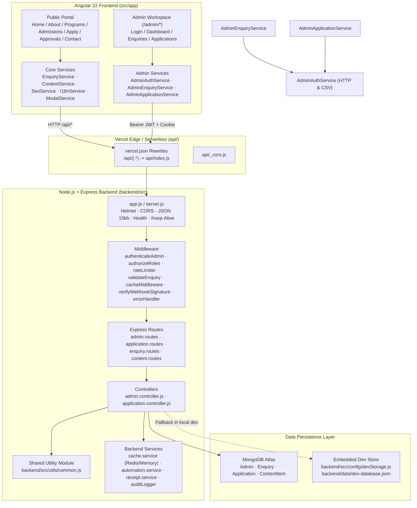
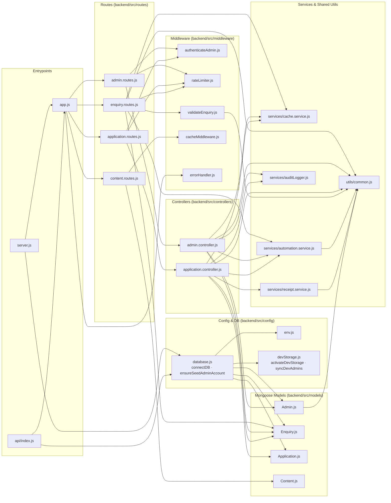
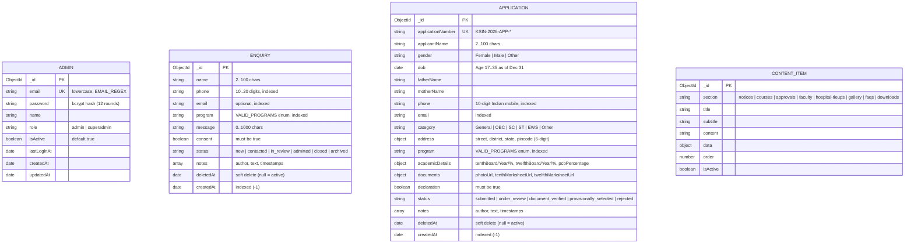

# Kavya Shree Institute of Nursing — Codebase Architecture & Dependency Graph

> [!IMPORTANT]
> **Fast Context Reference for AI Agents & Developers:** Read this file first before scanning the repository. It maps every frontend route, component, service, backend route, controller, middleware, model, shared utility, and test suite in `kavya-shree-nursing`.

---

## 1. End-to-End System Topology

---

## 2. Backend Module Dependency Graph (`backend/src`)

---

## 3. Frontend Route, Component & Service Graph (`src/app`)

```mermaid
flowchart TB
  AppRoot["App (src/app/app.ts)\nHeaderComponent · RouterOutlet · FooterComponent · EnquiryModalComponent"]

  subgraph PublicRoutes["Public Routes (src/app/app.routes.ts)"]
    R_Home["/ -> HomeComponent"]
    R_About["/about -> AboutComponent"]
    R_Programs["/programs -> ProgramsComponent"]
    R_CourseDetail["/programs/:id -> CourseDetailComponent"]
    R_Admissions["/admissions -> AdmissionsComponent"]
    R_Apply["/apply -> ApplyComponent"]
    R_Approvals["/approvals -> ApprovalsComponent"]
    R_Gallery["/gallery -> GalleryComponent"]
    R_Contact["/contact -> ContactComponent"]
    R_Legal["/privacy-policy · /terms-of-use · /disclaimer · /grievance"]
  end

  subgraph AdminRoutes["Admin Routes (/admin/*)"]
    R_AdminLogin["/admin/login -> AdminLoginComponent\n(adminLoginGuard)"]
    R_AdminLayout["/admin -> AdminLayoutComponent\n(adminAuthGuard)"]
    R_Dashboard["/admin/dashboard -> AdminDashboardComponent"]
    R_EnqList["/admin/enquiries -> AdminEnquiryListComponent"]
    R_EnqDetail["/admin/enquiries/:id -> AdminEnquiryDetailComponent"]
    R_AppList["/admin/applications -> AdminApplicationListComponent"]
  end

  subgraph FrontendServices["Frontend Services"]
    S_Content["ContentService\n(Signal cache + Fallback Content)"]
    S_Enquiry["EnquiryService\n(POST /api/enquiries)"]
    S_AdminAuth["AdminAuthService\n(Session, JWT, request<T>, downloadCsv, buildFilterQueryString)"]
    S_AdminEnq["AdminEnquiryService"]
    S_AdminApp["AdminApplicationService"]
    S_Seo["SeoService · I18nService · ModalService · MotionService"]
  end

  AppRoot --> PublicRoutes
  AppRoot --> AdminRoutes
  R_AdminLayout --> R_Dashboard
  R_AdminLayout --> R_EnqList
  R_AdminLayout --> R_EnqDetail
  R_AdminLayout --> R_AppList

  R_Home & R_Programs & R_CourseDetail & R_Approvals & R_Gallery --> S_Content
  R_Contact & R_Admissions --> S_Enquiry
  R_Dashboard & R_EnqList & R_EnqDetail --> S_AdminEnq
  R_AppList --> S_AdminApp
  R_AdminLogin & R_AdminLayout --> S_AdminAuth
  S_AdminEnq --> S_AdminAuth
  S_AdminApp --> S_AdminAuth
```

---

## 4. Data Models & Entity Schema (`backend/src/models`)

---

## 5. Complete API Endpoint Matrix

| Method & Path | Auth / Middleware | Handler | Purpose |
| :--- | :--- | :--- | :--- |
| `GET /api/health` | Public | `app.js` | Health check (`200` connected, `503` disconnected) |
| `GET /api/content/:section` | Public + `cacheMiddleware` (600s) | `content.routes.js` | Dynamic/fallback content (`notices`, `courses`, `approvals`, `faculty`, `hospital-tieups`, `gallery`, `faqs`, `downloads`) |
| `POST /api/enquiries` | Public + `enquiryLimiter` + `validateEnquiry` | `enquiry.routes.js` | Submit candidate enquiry (60s deduplication + Telegram/webhook alert) |
| `POST /api/applications` | Public + `enquiryLimiter` | `application.controller.submitApplication` | Submit online admission application (age 17-35, PIN, %, URL checks, 60s deduplication) |
| `GET /api/applications/:appNumber` | Public + `lookupLimiter` | `application.controller.getApplicationStatus` | Check application status by reference number |
| `GET /api/applications/:appNumber/receipt` | Public + `lookupLimiter` | `application.controller.getApplicationReceipt` | Printable HTML slip (masks phone/email/street publicly) |
| `POST /api/admin/login` | Public + `loginLimiter` (5/15m) | `admin.controller.login` | Admin login -> issues HS256 JWT + `httpOnly` cookie |
| `POST /api/admin/logout` | `authenticateAdmin` | `admin.controller.logout` | Clears `ks_admin_token` cookie |
| `GET /api/admin/me` | `authenticateAdmin` | `admin.controller.getMe` | Returns current authenticated admin profile |
| `PATCH /api/admin/me/password` | `authenticateAdmin` | `admin.controller.changePassword` | Verifies current password, updates hash, invalidates session cache |
| `GET /api/admin/stats` | `authenticateAdmin` | `admin.controller.getDashboardStats` | Cached (30s) status aggregation + 5 most recent enquiries |
| `GET /api/admin/enquiries` | `authenticateAdmin` | `admin.controller.listEnquiries` | Paginated, filtered, regex-escaped enquiry list |
| `GET /api/admin/enquiries/export` | `authenticateAdmin` + `exportLimiter` | `admin.controller.exportEnquiries` | Formula-safe CSV export of enquiries |
| `GET /api/admin/enquiries/:id` | `authenticateAdmin` | `admin.controller.getEnquiryById` | Single enquiry detail + notes |
| `PATCH /api/admin/enquiries/:id/status` | `authenticateAdmin` | `admin.controller.updateEnquiryStatus` | Update enquiry status + audit log + webhook notification |
| `POST /api/admin/enquiries/:id/notes` | `authenticateAdmin` | `admin.controller.addEnquiryNote` | Append sanitized staff note (author bound from JWT) |
| `DELETE /api/admin/enquiries/:id` | `authenticateAdmin` (`superadmin`) | `admin.controller.deleteEnquiry` | Soft-delete enquiry (`deletedAt`) |
| `GET /api/admin/applications` & `/api/applications/admin` | `authenticateAdmin` | `application.controller.listApplications` | Paginated, filtered application list |
| `GET /api/admin/applications/export` & `/api/applications/admin/export` | `authenticateAdmin` + `exportLimiter` | `application.controller.exportApplications` | Formula-safe CSV export of applications |
| `GET /api/admin/applications/:id` & `/api/applications/admin/:id` | `authenticateAdmin` | `application.controller.getApplicationById` | Full application detail |
| `GET /api/admin/applications/:id/receipt` & `/api/applications/admin/:id/receipt` | `authenticateAdmin` | `application.controller.getApplicationReceipt` | Unmasked staff printable HTML slip |
| `PATCH /api/admin/applications/:id/status` & `/api/applications/admin/:id/status` | `authenticateAdmin` | `application.controller.updateApplicationStatus` | Update application status + transition alert |
| `POST /api/admin/applications/:id/notes` & `/api/applications/admin/:id/notes` | `authenticateAdmin` | `application.controller.addApplicationNote` | Append sanitized note to application |
| `DELETE /api/admin/applications/:id` & `/api/applications/admin/:id` | `authenticateAdmin` (`superadmin`) | `application.controller.deleteApplication` | Soft-delete application (`deletedAt`) |

---

## 6. Fast File Directory Map

### Backend (`backend/`)
- `backend/src/utils/common.js` — Shared regexes (`EMAIL_REGEX`, `PHONE_REGEX`, `PINCODE_REGEX`), `sanitizeText`, `escapeHtml`, `escapeRegex`, `normalizePhone`, `escapeCsvCell`, `isSafeDocumentUrl`, `isSafeWebhookUrl`, `parsePagination`, `applyDateRangeFilter`, `createSubmissionDeduplicator`.
- `backend/src/config/env.js` — Environment loader, production validator (`validateProductionEnv`), placeholder URI guard (`isPlaceholderMongoUri`).
- `backend/src/config/database.js` — `connectDB`, `disconnectDB`, `getDatabaseStatus`, `ensureSeedAdminAccount`.
- `backend/src/config/devStorage.js` — Embedded JSON file store (`backend/data/dev-database.json`), `syncDevAdmins`, `attachCollectionHooks`.
- `backend/src/controllers/admin.controller.js` — Admin auth, dashboard stats, enquiry CRUD & CSV export.
- `backend/src/controllers/application.controller.js` — Public application submission, receipt/status lookup, admin application CRUD & CSV export.
- `backend/src/services/automation.service.js` — Non-blocking Telegram & HMAC-signed webhook notifications with SSRF & HTML-injection protection.
- `backend/src/services/cache.service.js` — Dual-layer Redis + in-memory TTL cache (`stats:dashboard`, `admin:session:*`, `content:*`).
- `backend/src/services/receipt.service.js` — Printable HTML application slip generator with public PII masking.
- `backend/src/services/auditLogger.js` — Structured `[AUDIT]` logger (`logAdminAction`).
- `backend/tests/*.test.js` — 12 test files (`114` tests total; run with `node --test backend/tests/*.test.js`).

### Frontend (`src/app/`)
- `src/app/app.routes.ts` — All lazy-loaded public and `/admin/*` routes.
- `src/app/core/data/fallback-content.ts` — Offline-first institutional courses, notices, approvals, faculty, FAQs, downloads.
- `src/app/core/services/` — `content.service.ts`, `enquiry.service.ts`, `seo.service.ts`, `i18n.service.ts`, `modal.service.ts`, `motion.service.ts`.
- `src/app/pages/admin/services/admin-auth.service.ts` — Session state (`currentUser` signal), `login` (with `/api` fallback), `request<T>`, `downloadCsv`, `buildFilterQueryString`.
- `src/app/pages/admin/services/admin-enquiry.service.ts` — Enquiry API wrapper delegating to `AdminAuthService`.
- `src/app/pages/admin/services/admin-application.service.ts` — Application API wrapper delegating to `AdminAuthService`.

